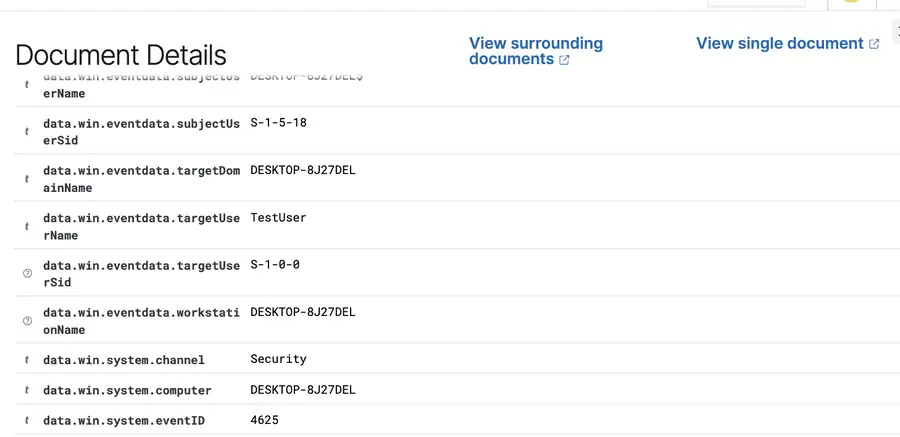

# Investigation 01 — Windows Authentication Failure

## Executive Summary

This investigation validates the endpoint-to-SIEM monitoring pipeline in the SOC Analyst lab by generating controlled failed logon attempts against a local Windows 11 account and tracing the resulting security telemetry through Windows Event Viewer and Wazuh.

The Windows endpoint generated **Security Event ID 4625** for failed authentication attempts against the local account `TestUser`. The Wazuh agent collected the Windows Security events, forwarded them to the Wazuh server, and triggered **Wazuh Rule 60122 — "Logon Failure - Unknown user or bad password."**

Six matching Wazuh alerts were identified and reviewed.

**Final disposition:** Benign / Authorized Testing

---

## Investigation Objective

Confirm that a SOC analyst can trace a known authentication event through the complete monitoring workflow:

```text
Failed logon attempt
        ↓
Windows Security Event Log
        ↓
Wazuh Agent
        ↓
Wazuh Manager
        ↓
Wazuh Detection Rule
        ↓
Wazuh Dashboard
        ↓
Analyst Triage and Assessment
```

---

## Lab Environment

| Component | Role |
|---|---|
| Windows 11 Pro VM | Monitored endpoint |
| Wazuh Agent v4.14.10 | Endpoint telemetry collection |
| Ubuntu Server VM | Wazuh server |
| Wazuh Manager | Event analysis and rule evaluation |
| Wazuh Indexer | Security-event storage and search |
| Wazuh Dashboard | SIEM investigation and alert triage |
| VMware Fusion | Virtualized lab environment |

---

## Test Scenario

A local Windows account named `TestUser` was used to generate controlled authentication failures.

Several incorrect passwords were intentionally entered at the Windows sign-in screen. The activity was performed inside an isolated, personally owned lab environment.

This created a known event that could be followed from the endpoint through the SIEM.

---

## Detection Summary

| Field | Observed Value |
|---|---|
| Endpoint | `Windows11EndpointVM` |
| Windows Event ID | **4625** |
| Target Account | `TestUser` |
| Target Domain | `DESKTOP-8J27DEL` |
| Security Channel | `Security` |
| Wazuh Description | Logon Failure - Unknown user or bad password |
| Wazuh Rule | **60122** |
| Wazuh Rule Level | **5** |
| Wazuh Alerts Observed | **6** |
| Analyst Disposition | **Benign / Authorized Testing** |

---

## 1. Verify Windows Logon Auditing

Windows auditing was checked from an Administrator PowerShell session:

```powershell
auditpol /get /subcategory:"Logon"
```

The policy showed:

```text
Logon    Success and Failure
```

This confirmed that the endpoint was configured to record both successful and failed logon activity.

---

## 2. Validate the Endpoint Event

Event Viewer was filtered for Event ID 4625, confirming that the failed authentication attempts were present in the local Windows Security log and associated with `TestUser`.


*Windows Event Viewer confirming failed logon events for the local test account.*

### Endpoint Finding

The evidence confirmed that the event existed **before** Wazuh processing. This separated endpoint logging from SIEM collection and helped isolate the monitoring pipeline during troubleshooting.


---

## 3. Locate the SIEM Alert

The Wazuh Threat Hunting interface was searched for the authentication-related rules:

```text
rule.id:(60122 OR 60204)
```

The search returned **six alerts**, all associated with:

```text
Rule ID: 60122
Rule Level: 5
Description: Logon Failure - Unknown user or bad password
Agent: Windows11EndpointVM
```

The endpoint event had therefore successfully traveled through the monitoring pipeline and become searchable SIEM telemetry.


*Wazuh Threat Hunting showing six Rule 60122 failed-logon alerts from Windows11EndpointVM.*

---

## 4. Analyze the Alert

The Wazuh document details provided additional context about the authentication failure.



*Wazuh document details correlating the target account, endpoint, Security channel, and Windows Event ID 4625.*

### Target Account

```text
TestUser
```

### Windows Event

```text
Event ID: 4625
Channel: Security
```

---

## Event Correlation

The investigation correlated three views of the same activity:

```text
Known analyst action
        ↓
Windows Event ID 4625
        ↓
Wazuh Rule 60122
```

The shared account, host, event type, and timing allowed the endpoint evidence to be correlated with the centralized SIEM alert.

---

## Timestamp Observation

A time difference was observed between timestamps displayed by Windows and the Wazuh dashboard.

Windows and Wazuh displayed the same activity using different apparent times during the investigation.

This became an additional troubleshooting lesson: **time-zone awareness is important when correlating security events across multiple systems.**

---

## MITRE ATT&CK Context

Wazuh included MITRE ATT&CK metadata with the alert.

Automated ATT&CK mappings provide useful context, but they do not replace analyst validation. In this investigation, the activity was a controlled password-failure test and did not demonstrate malicious activity.

This reinforces an important SOC principle:

> A detection rule or framework mapping is evidence to evaluate, not a conclusion to accept automatically.

---

## Analyst Assessment

### Classification

**Benign / Expected Activity**

### Rationale

The failed authentication attempts were intentionally generated as part of an authorized lab exercise. The evidence matched the known test activity:

- Expected endpoint
- Expected test account
- Windows Event ID 4625
- Matching Wazuh failed-logon alert
- Timing consistent with the controlled test activity

There was no evidence in this scenario of unauthorized remote access or malicious activity.

### Disposition

**Closed — Authorized Testing**

---

## Skills Demonstrated

- Security Information and Event Management (**SIEM**)
- SOC alert triage
- Windows Security Event Log analysis
- Windows Event ID 4625 investigation
- Authentication monitoring
- Endpoint telemetry analysis
- Wazuh Threat Hunting
- Wazuh rule analysis
- Event correlation
- PowerShell event-log querying
- Detection validation
- Incident classification
- Timestamp/time-zone troubleshooting
- Technical incident documentation

---

## Evidence Captured

The `evidence/` directory contains the verified screenshots used in this investigation:

- [Windows Event Viewer — Event ID 4625](evidence/windows-event-viewer-4625.webp)
- [Wazuh Threat Hunting — Rule 60122](evidence/wazuh-rule-60122-alerts.webp)
- [Wazuh Event ID 4625 document details](evidence/wazuh-document-details-4625.webp)

Credential-bearing setup screenshots and browser screenshots containing unrelated personal information are intentionally excluded from the public repository.

---

## Conclusion

The first investigation successfully validated the complete Windows endpoint-to-Wazuh SIEM workflow.

The lab demonstrated that a controlled authentication failure could be generated, recorded locally, collected by the Wazuh agent, analyzed by the Wazuh manager, indexed, detected by a Wazuh rule, and triaged through the browser-based dashboard.

This establishes the baseline monitoring environment for future SOC investigations involving richer endpoint and network telemetry.
