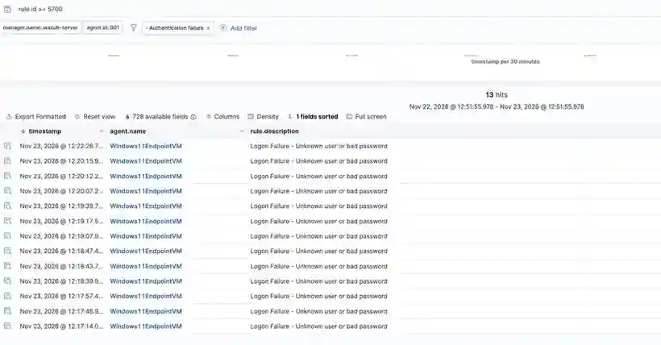
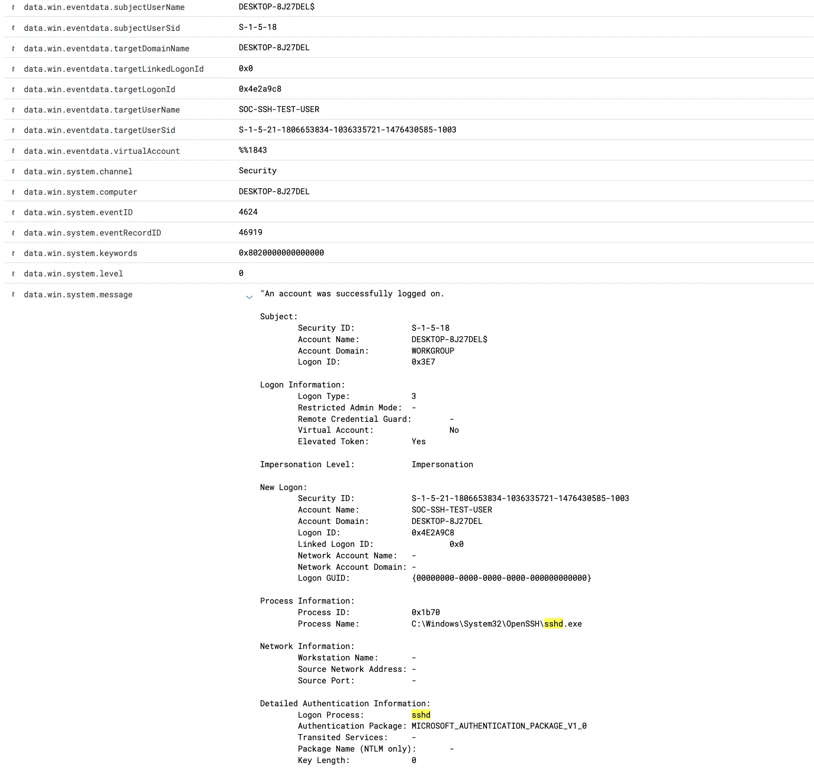
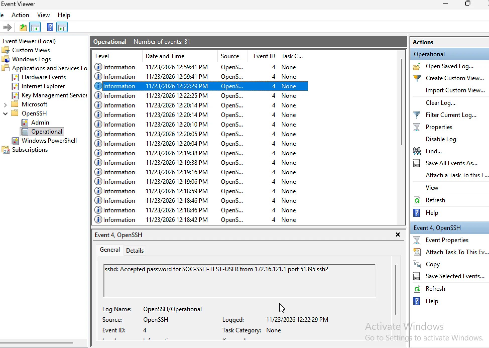
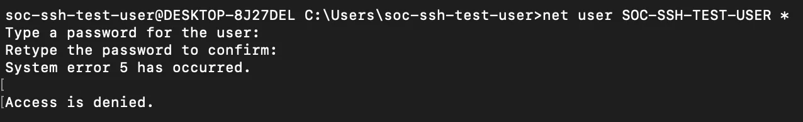
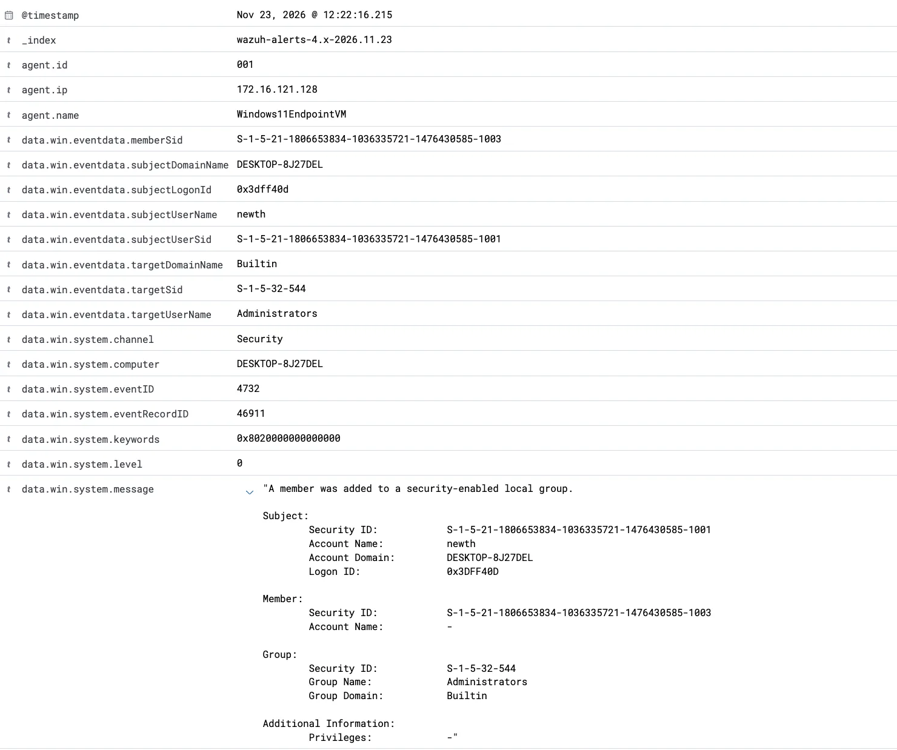
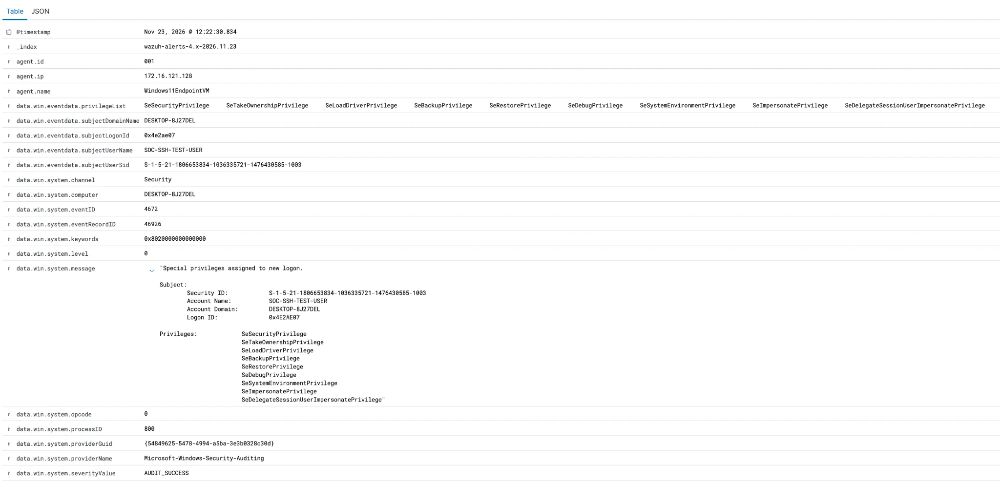
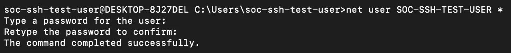
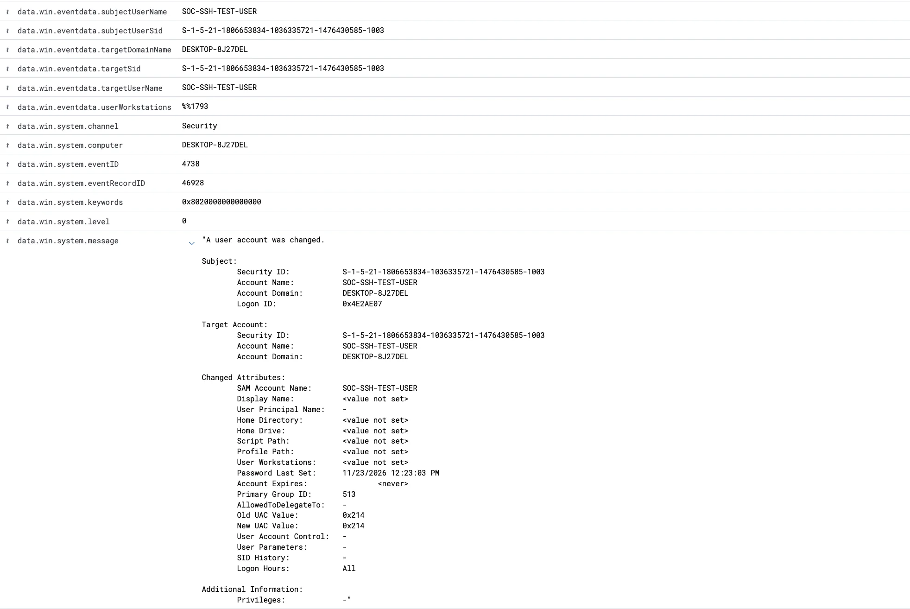

# Investigation 02 — Remote SSH Authentication and Privilege Change

## Executive Summary

This investigation examined remote SSH authentication activity against the monitored Windows 11 endpoint and followed the activity through Windows logging and Wazuh.

A local test account named `SOC-SSH-TEST-USER` was used for repeated remote SSH attempts from the Mac host. Both failed and successful logons were generated. After a successful SSH session, the account attempted to change its own password with `net user SOC-SSH-TEST-USER *`, but Windows returned **System error 5 — Access is denied** because the account had not yet been added to the local Administrators group.

The test account was then added locally to the Windows **Administrators** group. After reconnecting through SSH, the account received elevated privileges and the same password-change command completed successfully.

Wazuh captured the related Windows Security events. The Windows OpenSSH Operational log separately recorded the remote SSH source as `172.16.121.1` on the VMware NAT network.

**Final disposition:** Benign / Authorized Testing

---

## Investigation Objective

Trace a controlled remote SSH session from authentication through privilege change and account modification:

```text
Mac SSH client
      ↓
Windows OpenSSH Server
      ↓
Windows Security / OpenSSH logs
      ↓
Wazuh Agent
      ↓
Wazuh Dashboard
      ↓
Analyst correlation and assessment
```

---

## Lab Environment

| Component | Role |
|---|---|
| Mac host | Remote SSH client |
| Windows 11 Pro VM | Monitored SSH endpoint |
| OpenSSH Server | Accepts inbound SSH connections |
| Wazuh Agent | Collects Windows security telemetry |
| Ubuntu Server VM | Hosts Wazuh infrastructure |
| Wazuh Dashboard | SIEM investigation and event review |
| VMware Fusion NAT | Virtual networking between host and VM |

---

## Test Scenario

The Windows endpoint was configured with OpenSSH Server and a local account named `SOC-SSH-TEST-USER`.

From the Mac command line, repeated SSH authentication attempts were made against the Windows endpoint. Some attempts intentionally used an incorrect password, followed by successful authentication.

After logging in successfully through SSH, the test account ran:

```cmd
net user SOC-SSH-TEST-USER *
```

Windows initially returned:

```text
System error 5 has occurred.
Access is denied.
```

The account was then added locally to the Windows **Administrators** group. After a new SSH logon, the same password-change command completed successfully.

---

## Detection Summary

| Finding | Observed Evidence |
|---|---|
| Monitored endpoint | `Windows11EndpointVM` |
| Endpoint IP | `172.16.121.128` |
| Test account | `SOC-SSH-TEST-USER` |
| Failed authentication alerts | **13** Wazuh hits |
| Successful authentication alerts | **2** Wazuh hits |
| Successful Windows logon event | **4624** |
| Successful logon type | **3** |
| SSH process | `C:\Windows\System32\OpenSSH\sshd.exe` |
| SSH logon process | `sshd` |
| OpenSSH source address | `172.16.121.1` |
| Local group membership event | **4732** |
| Privileged logon event | **4672** |
| Account-change event | **4738** |
| Final disposition | **Benign / Authorized Testing** |

---

## 1. Review Remote Authentication Activity

Wazuh displayed **13 authentication failures** from the endpoint with:

```text
Logon Failure - Unknown user or bad password
```

Wazuh also displayed **2 authentication successes** with:

```text
Windows Logon Success
```

This confirmed that both failed and successful authentication activity reached the SIEM.



*Wazuh showing the repeated authentication failures generated during the remote SSH test.*

---

## 2. Validate the Successful SSH Logon

A Wazuh event for Windows **Event ID 4624** showed:

```text
Account Name: SOC-SSH-TEST-USER
Account Domain: DESKTOP-8J27DEL
Logon Type: 3
```

The same event identified:

```text
Process Name: C:\Windows\System32\OpenSSH\sshd.exe
Logon Process: sshd
```

This tied the successful Windows network logon directly to OpenSSH.

The generic 4624 event did **not** populate the source network address or source port; both were shown as `-` in the captured event.



*Wazuh Event ID 4624 showing `SOC-SSH-TEST-USER`, Logon Type 3, and the OpenSSH `sshd.exe` process.*

---

## 3. Identify the Remote SSH Source

The Windows **OpenSSH/Operational** log supplied the source information that was missing from the generic Security event.

The captured event showed:

```text
sshd: Accepted password for SOC-SSH-TEST-USER from 172.16.121.1 port 51395 ssh2
```

This confirmed that the successful SSH session originated from `172.16.121.1` on the VMware NAT network.



*Windows OpenSSH Operational log identifying the SSH source as `172.16.121.1` and source port `51395`.*

---

## 4. Observe the Initial Password-Change Failure

Inside the first successful SSH session, the test account attempted:

```cmd
net user SOC-SSH-TEST-USER *
```

Windows returned:

```text
System error 5 has occurred.
Access is denied.
```

At this point the account had not yet been added to the local Administrators group.

This demonstrated that successful authentication did not automatically grant the account administrative authorization.



*Remote SSH session showing the initial `net user SOC-SSH-TEST-USER *` attempt failing with System error 5 and Access is denied.*

---

## 5. Correlate the Administrators Group Change

The account was then added locally to the Windows **Administrators** group.

Wazuh captured Windows **Event ID 4732**:

```text
A member was added to a security-enabled local group.
```

The event showed:

```text
Group Name: Administrators
Group Domain: Builtin
```

The member SID in the 4732 event matched the SID associated with `SOC-SSH-TEST-USER` in the other captured events, allowing the group-membership change to be correlated with the test account.



*Wazuh Event ID 4732 showing a member added to the built-in Administrators group.*

---

## 6. Validate the Privileged SSH Logon

After the group-membership change, a new SSH session was established.

Wazuh captured Windows **Event ID 4672** for `SOC-SSH-TEST-USER`:

```text
Special privileges assigned to new logon.
```

The captured event listed privileges including:

```text
SeSecurityPrivilege
SeTakeOwnershipPrivilege
SeLoadDriverPrivilege
SeBackupPrivilege
SeRestorePrivilege
SeDebugPrivilege
SeSystemEnvironmentPrivilege
SeImpersonatePrivilege
SeDelegateSessionUserImpersonatePrivilege
```

This provided evidence that the new logon session received elevated Windows privileges after the account was added to Administrators.



*Wazuh Event ID 4672 showing special privileges assigned to the new `SOC-SSH-TEST-USER` logon.*

---

## 7. Confirm the Password Change

After reconnecting through SSH with the elevated account, the same command was run again:

```cmd
net user SOC-SSH-TEST-USER *
```

This time Windows returned:

```text
The command completed successfully.
```

Wazuh also captured Windows **Event ID 4738**:

```text
A user account was changed.
```

The event identified `SOC-SSH-TEST-USER` as the target account and showed:

```text
Password Last Set: 11/23/2026 12:23:03 PM
```

The successful command output and the account-change event together supported the conclusion that the password modification succeeded after the account gained administrative privileges.



*Remote SSH session showing the same password-change command completing successfully after administrator membership.*



*Wazuh Event ID 4738 showing `SOC-SSH-TEST-USER` was changed and recording the updated Password Last Set value.*

---

## Event Correlation

```text
Repeated SSH authentication attempts from Mac
                ↓
Wazuh records failed and successful authentication
                ↓
Event 4624 confirms SOC-SSH-TEST-USER network logon
                ↓
sshd.exe / sshd identifies the SSH process
                ↓
OpenSSH log records source 172.16.121.1
                ↓
Password-change command fails with Access Denied
                ↓
Account added to local Administrators group
                ↓
Event 4732 records group-membership change
                ↓
New SSH session receives special privileges
                ↓
Event 4672 records privileged logon
                ↓
Password-change command succeeds
                ↓
Event 4738 records account change
```

---

## Analyst Assessment

### Classification

**Benign / Expected Activity**

### Rationale

All authentication attempts, privilege changes, and password modifications were intentionally generated inside a personally owned lab environment.

The evidence consistently identified the expected endpoint and the expected `SOC-SSH-TEST-USER` account. The OpenSSH log also identified the expected VMware NAT source used by the Mac SSH client.

No evidence in this investigation indicated unauthorized access.

### Disposition

**Closed — Authorized Testing**

---

## Skills Demonstrated

- Remote SSH authentication
- Windows OpenSSH Server
- Windows Event ID 4624 analysis
- Windows Event ID 4732 analysis
- Windows Event ID 4672 analysis
- Windows Event ID 4738 analysis
- Windows local-group administration
- Authentication failure and success analysis
- Privilege-change correlation
- Account-change analysis
- Wazuh SIEM investigation
- Windows Security Event Log analysis
- OpenSSH Operational log analysis
- Source-address correlation
- Endpoint telemetry analysis
- Technical incident documentation

---

## Evidence Captured

The `evidence/` directory contains the screenshots used to support the findings in this investigation:

- [Wazuh authentication failures](evidence/01-wazuh-authentication-failures.webp)
- [Wazuh Event ID 4624 SSH logon details](evidence/02-wazuh-4624-ssh-logon-details.webp)
- [OpenSSH source-address evidence](evidence/03-openssh-source-address.webp)
- [Wazuh Event ID 4732 Administrators-group change](evidence/04-wazuh-4732-administrators-group.webp)
- [Wazuh Event ID 4672 special privileges](evidence/05-wazuh-4672-special-privileges.webp)
- [Terminal password-change denial](evidence/06-terminal-password-change-denied.webp)
- [Terminal password-change success](evidence/07-terminal-password-change-success.webp)
- [Wazuh Event ID 4738 account change](evidence/08-wazuh-4738-account-changed.webp)


---

## Conclusion

This investigation expanded the lab from local authentication testing into remote network authentication and privilege-change analysis.

The activity demonstrated that a remote SSH session could be traced across multiple evidence sources. Wazuh provided the centralized Windows security events, while the OpenSSH Operational log supplied the remote source information that the generic Windows 4624 event did not include.

The investigation also demonstrated the difference between authentication and authorization: the account could successfully log in through SSH before it had permission to perform the password-change operation. After the account was added to the local Administrators group, a new privileged logon occurred and the password-change command succeeded.
