# Investigation 03 — Sysmon Process Execution and Discovery

## Executive Summary

Sysmon Event ID 1 and Wazuh were used to investigate process execution on a Windows 11 endpoint. The objective was to identify discovery commands, establish parent-child process relationships, and review the resulting Wazuh alerts.

**Final disposition:** Benign / Authorized Testing

## 1. Review Sysmon Process Creation

In the initial test, five commands were executed from Command Prompt (PID 660).

| Command | Purpose |
|---|---|
| `whoami` | Identify the current user |
| `hostname` | Identify the computer |
| `ipconfig /all` | Obtain network configuration information |
| `net user` | Enumerate local user accounts |
| `notepad.exe` | Launch Notepad |

All five Sysmon events identified `cmd.exe` as their parent, with the same ParentProcessId (660) and ParentProcessGuid. All showed High integrity and the same user and logon session.

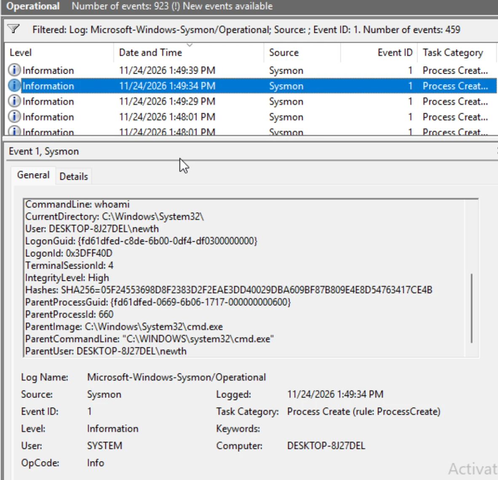

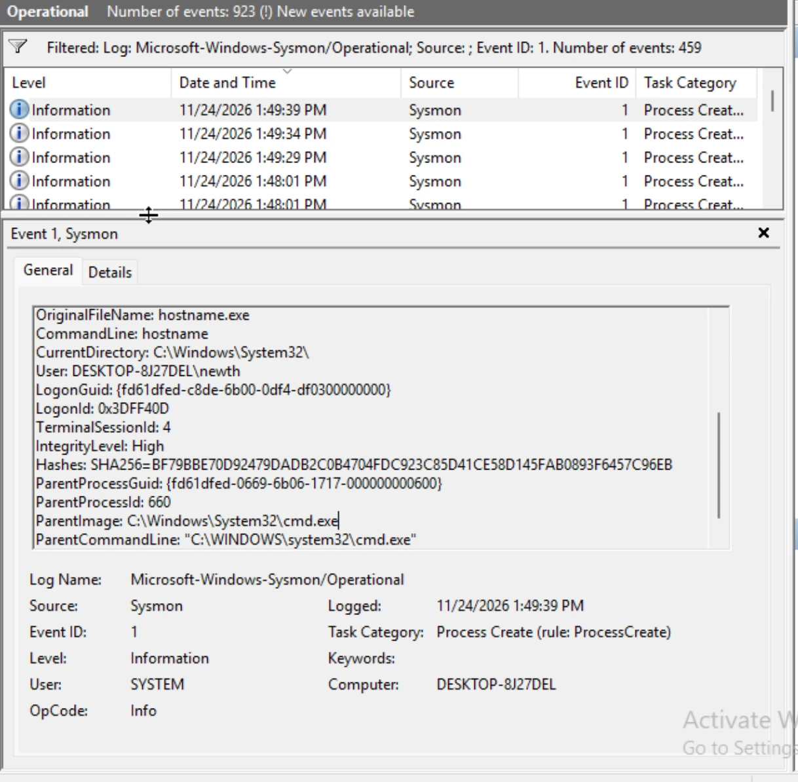

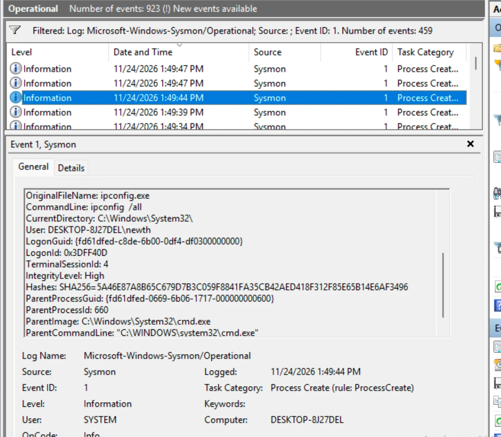

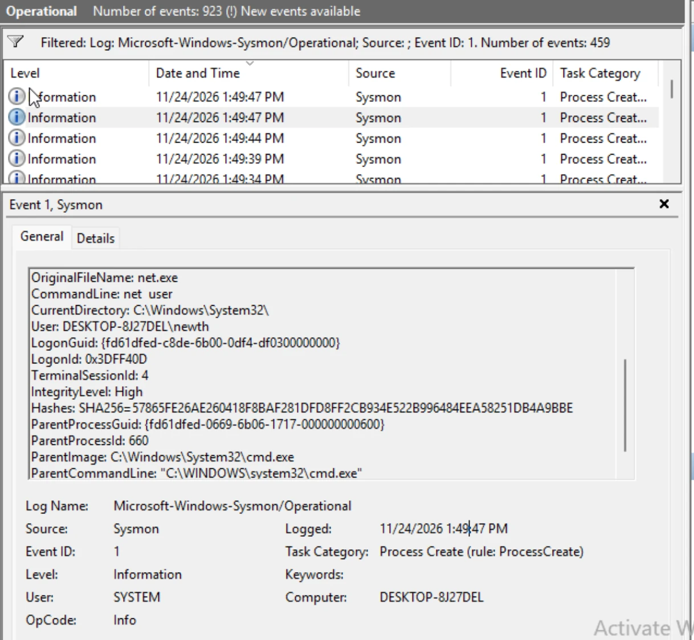

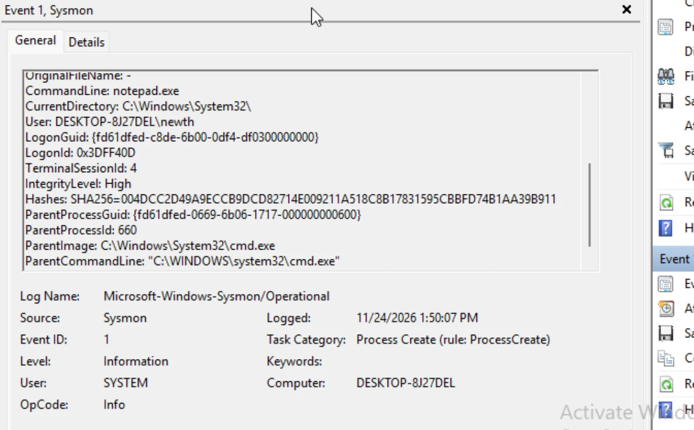

## 2. Investigate Process Execution in Wazuh

In a separate test, Wazuh recorded PowerShell (PID 7640) launching Command Prompt (PID 9244).

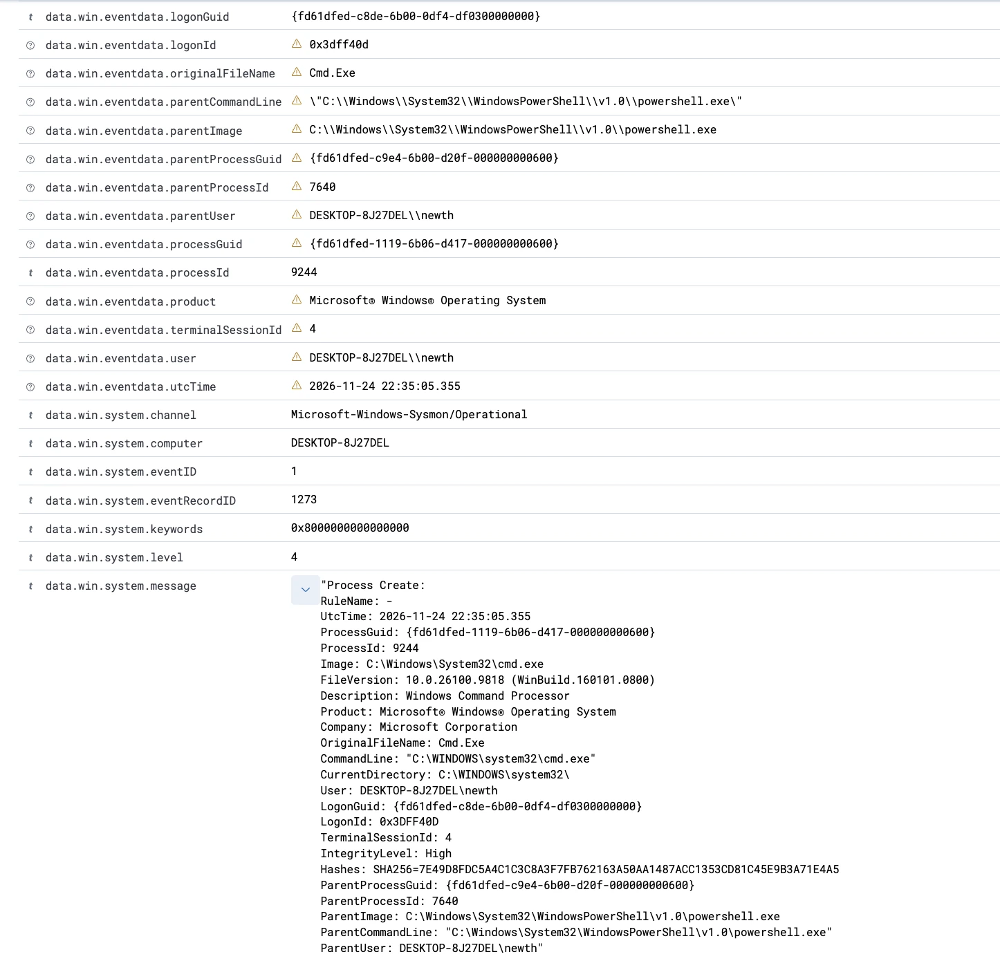

The Command Prompt process launched `net user` (PID 11776) to enumerate local accounts.

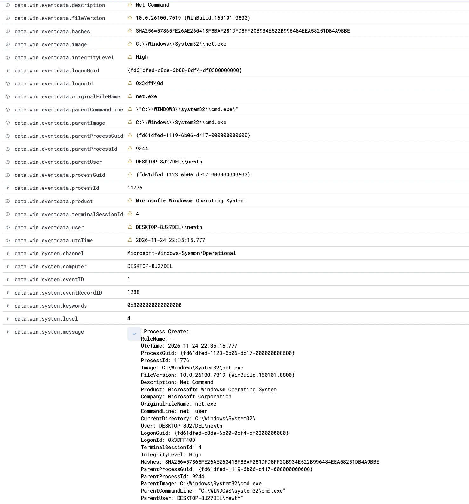

The same CMD instance also launched `net localgroup Administrators` (PID 8656) to enumerate local administrator group members. The exported alert shows the command and its parent identifiers.

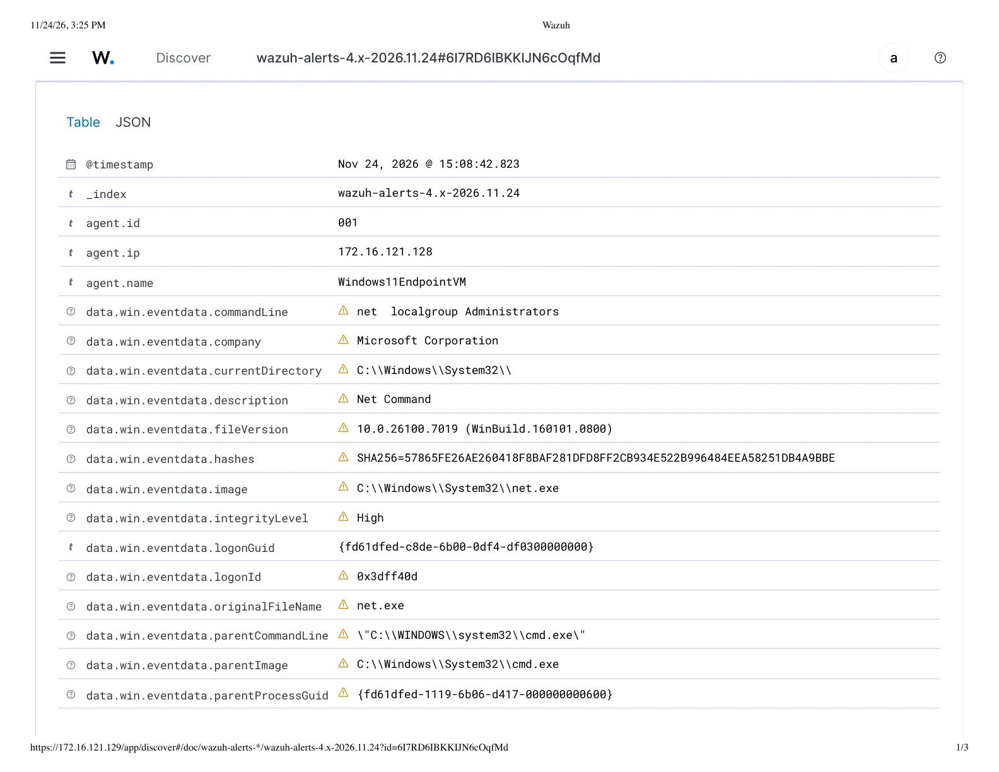

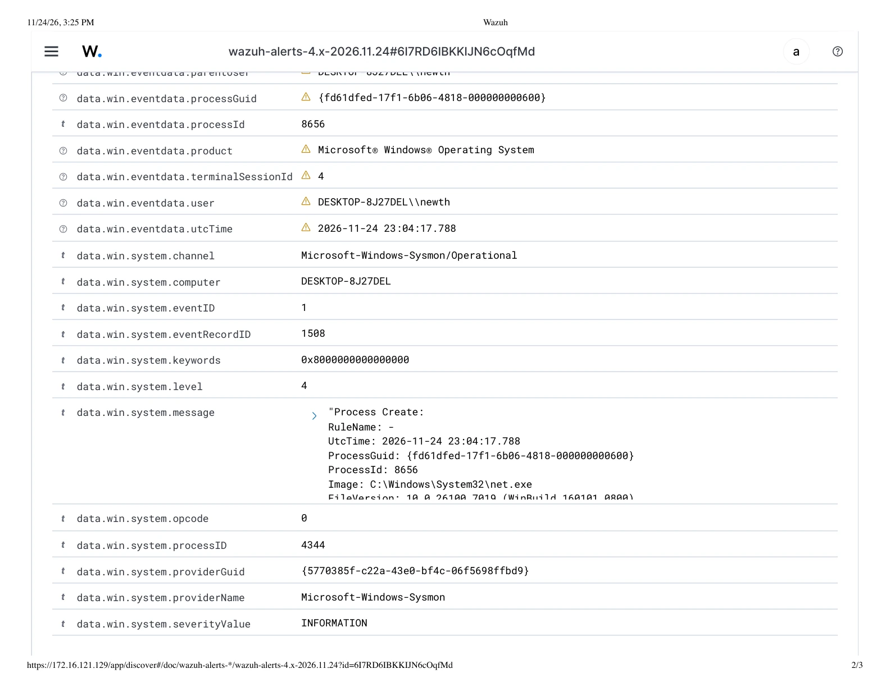

The `net.exe` process then launched `net1.exe` (PID 10404). The ParentProcessId and ParentProcessGuid in this event match the identifiers of the preceding `net.exe` process.

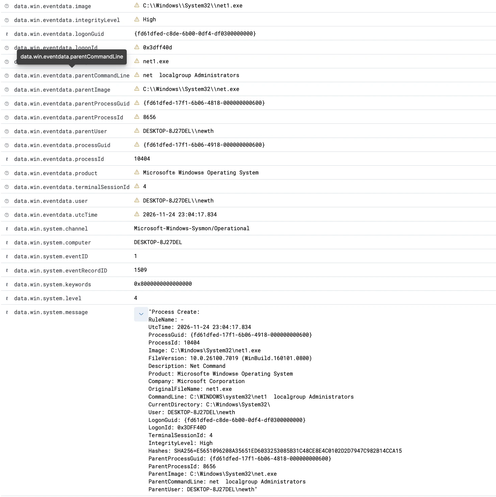

Finally, `net accounts` (PID 3136) was executed to obtain password and account policy information.

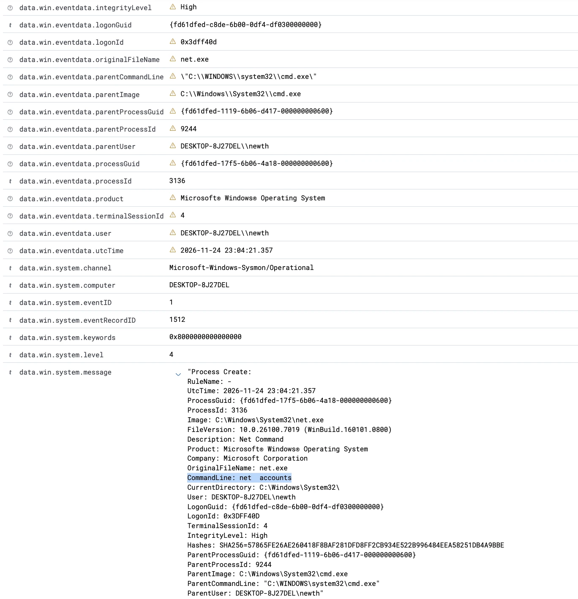

## 3. Process Correlation

The relationships were established by comparing each parent's ProcessId and ProcessGuid against the child's ParentProcessId and ParentProcessGuid.

```text
powershell.exe (PID 7640)
└── cmd.exe (PID 9244)
    ├── net.exe (PID 11776) — net user
    ├── net.exe (PID 8656) — net localgroup Administrators
    │   └── net1.exe (PID 10404)
    └── net.exe (PID 3136) — net accounts
```

## 4. Wazuh Detection

Wazuh classified the captured administrator group discovery event as follows:

| Field | Observed value |
|---|---|
| Sysmon Event ID | 1 — Process Create |
| Wazuh Rule ID | 92031 |
| Rule level | 3 |
| Rule description | Discovery activity executed |
| MITRE ATT&CK | T1087 — Account Discovery |

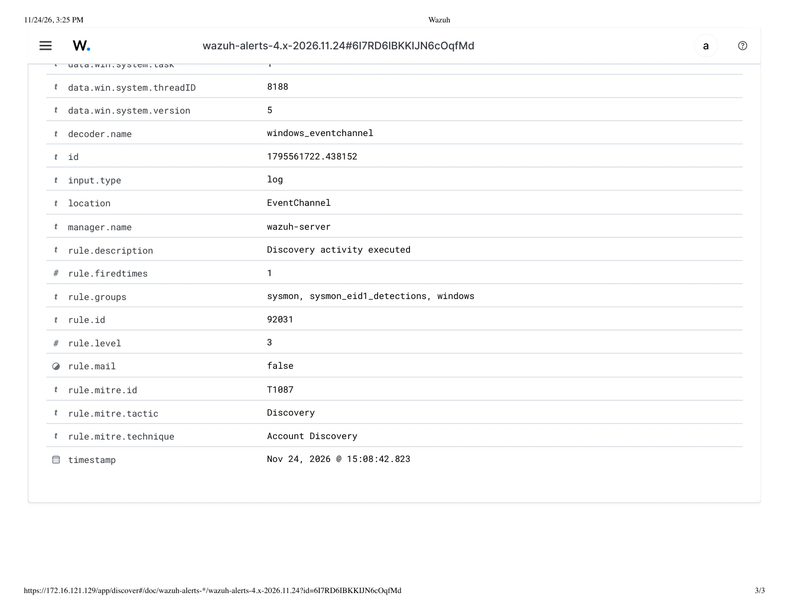

Not every process recorded in Sysmon appeared in the Wazuh alert index. Event archiving was disabled, and the existing alert threshold was level 3. The missing alerts alone do not establish whether those events reached the manager.

## Analyst Assessment

The discovery commands were intentionally executed in an authorized lab environment. Although these commands can be used by threat actors, the observed activity was expected and benign.

**Disposition:** Closed — Authorized Testing

## Evidence

The [evidence directory](evidence/) contains the original screenshot content exported as WebP images, including three pages rendered from the Wazuh alert PDF.
